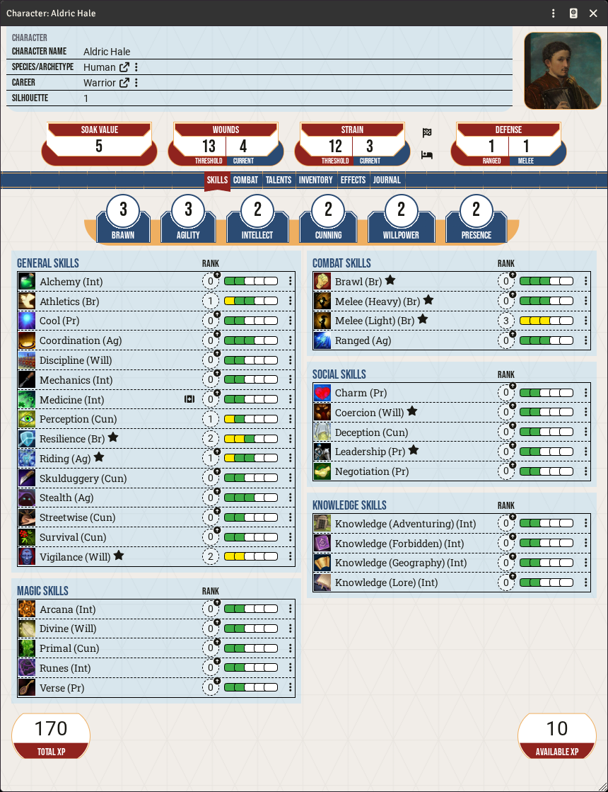
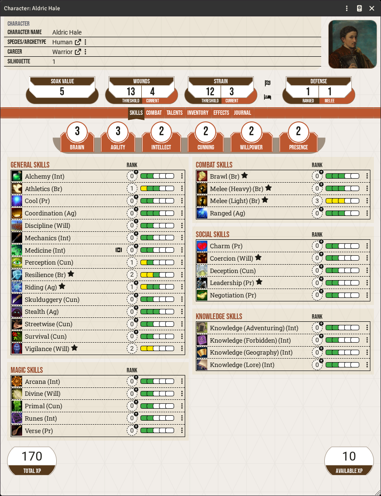
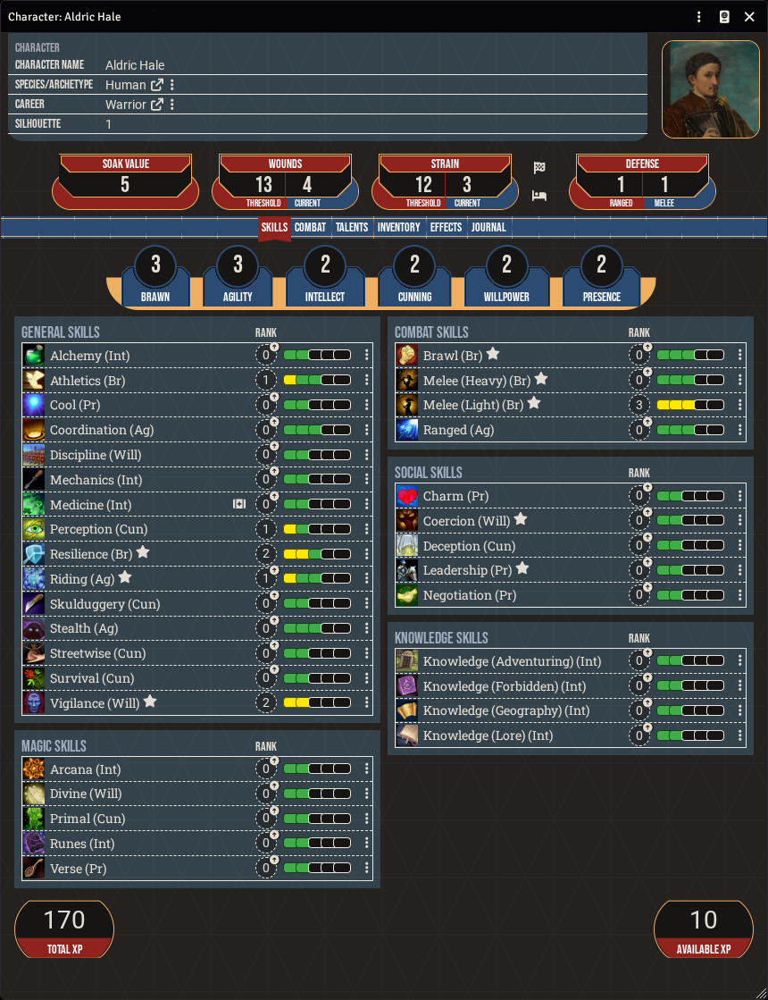
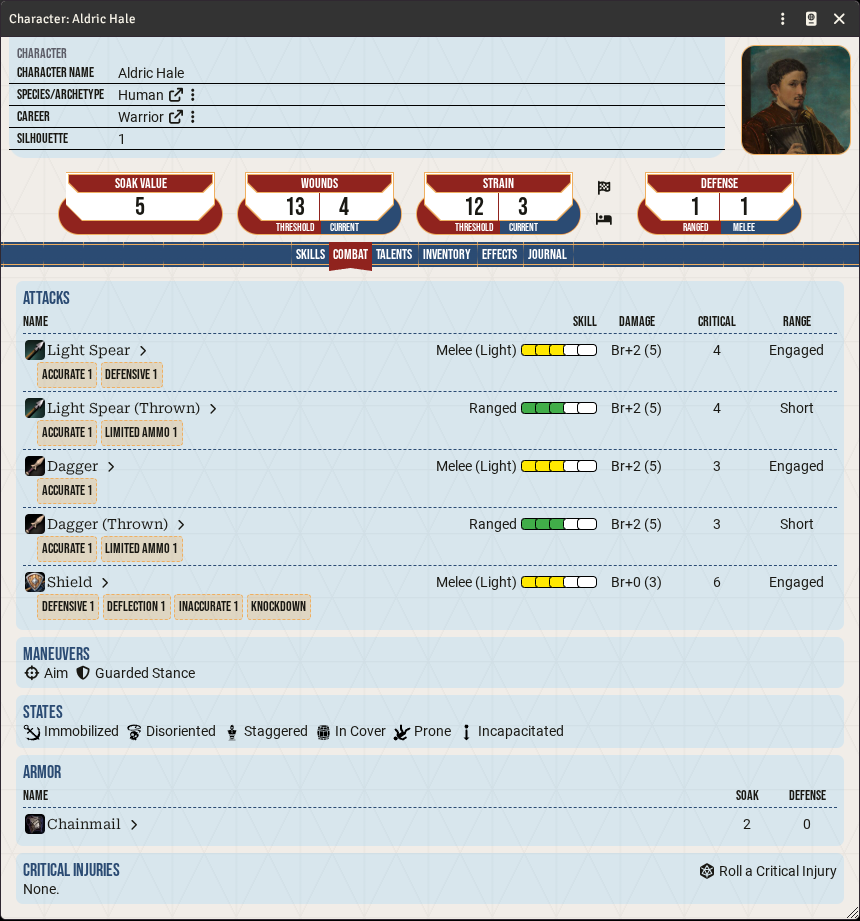
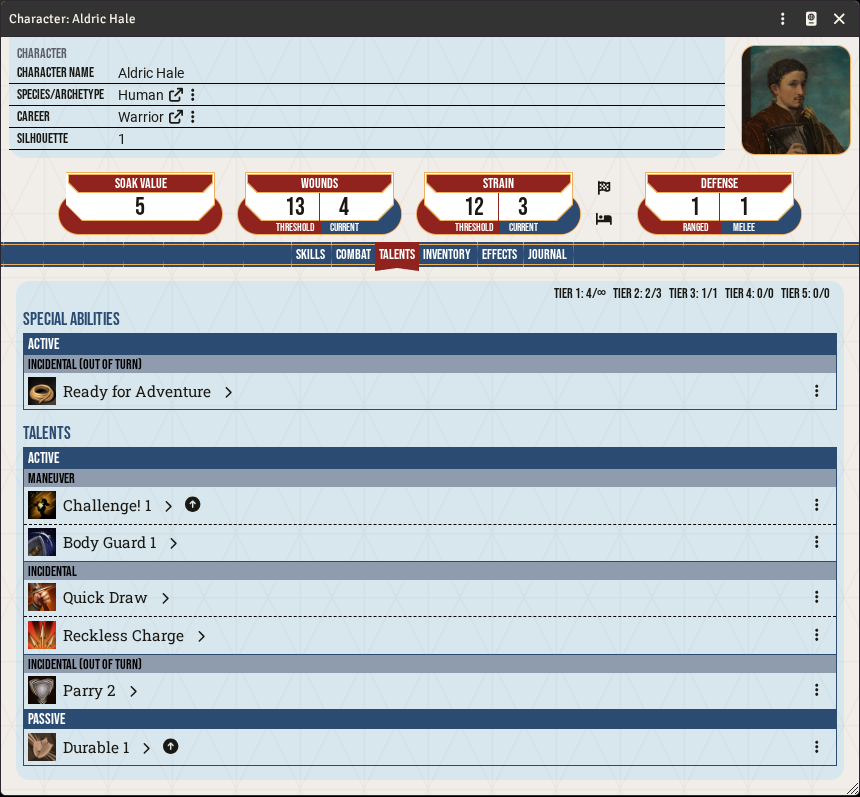
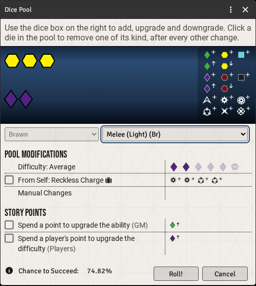
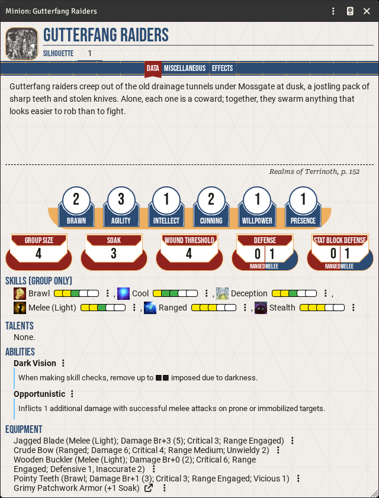
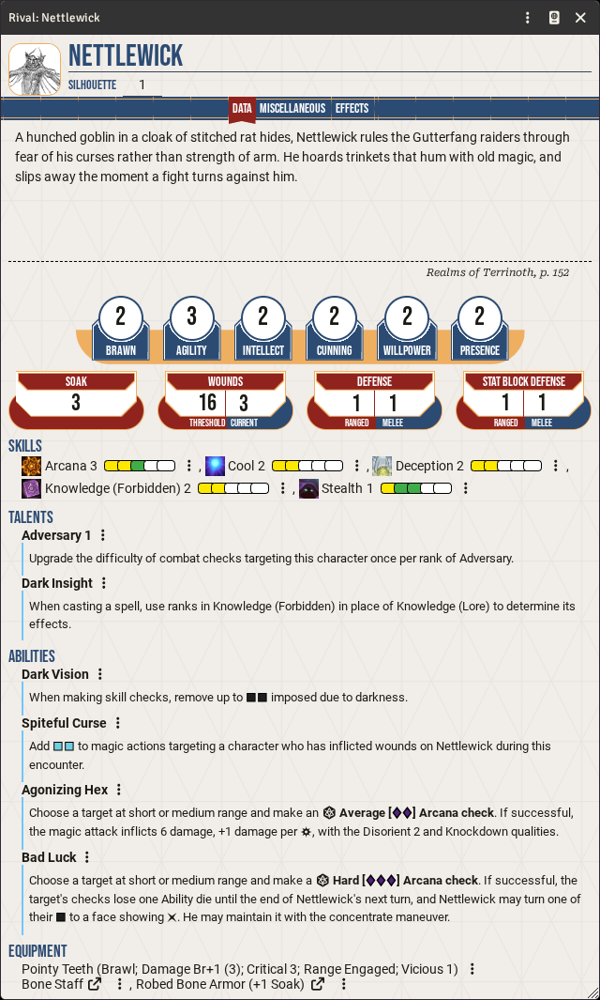
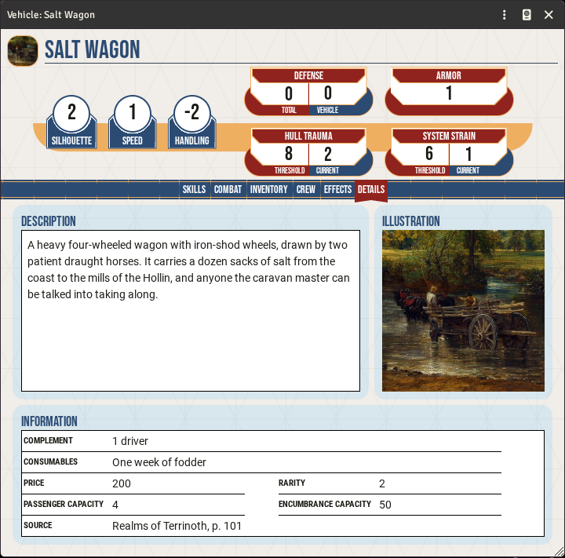
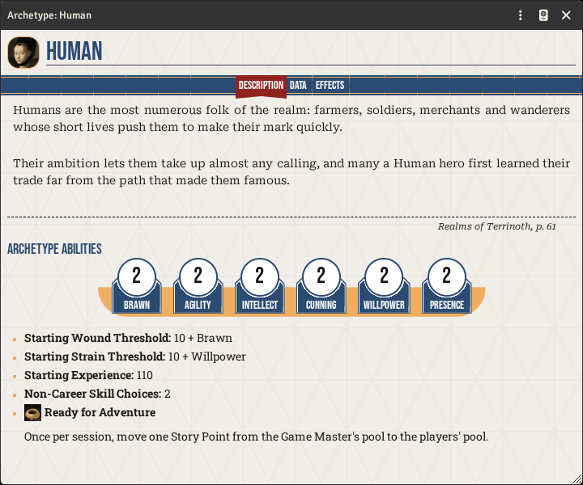

# FVTT Genesys
An implementation of [EDGE Studio](https://edge-studio.net/)'s Genesys roleplaying game for Foundry VTT, with the rules of the **Core Rulebook** and **Realms of Terrinoth**.

**[📦 Install](#installation)** · **[📖 Wiki](https://github.com/kornifex/FVTT-Genesys/wiki)** · **[🖼️ Screenshots](#screenshots)** · **[📝 Changelog](CHANGELOG.md)** · **[🐛 Report a bug](https://github.com/kornifex/FVTT-Genesys/issues)**



## About this fork
This repository continues the Genesys system created by [Mezryss](https://github.com/Mezryss/FVTT-Genesys) and maintained for a long time by Assembling Kings, with contributions from KitCat420 and many others. Thank you all for building it: nearly everything you see in this system is their work.

In [September 2026](https://github.com/Mezryss/FVTT-Genesys/issues/263#issuecomment-5642736832), Assembling Kings announced that the original system would likely not receive further updates, and that they are focusing on [a new implementation written from scratch](https://git.gay/assembling.kings/genesys). That new system is still in progress and not yet recommended for running games. It uses a different system id (`ak-genesys`), so worlds don't carry over between the two.

This fork keeps the existing system going for **tables with ongoing campaigns**: support for newer Foundry versions, bug fixes, and optional house rules. It keeps the original system id (`genesys`), so **your existing worlds, actors and settings work as they are, with no migration**. The reasoning is recorded in [ADR 0002](docs/adr/0002-publish-fork-under-genesys-id.md).

## What's new since the fork
Since release 0.2.19 of the original system, this fork has:

- 🖥️ **Foundry v14**: moved the sheets to Foundry's ApplicationV2, then the system to Foundry v13 and v14, and now to v14 alone.
- ♿ **Accessibility**: every sheet is usable from the keyboard and with a screen reader, with text at WCAG contrast in both Styles, a ⋮ menu of actions on every row, and compact counters.
- 🌗 **Light and dark themes**: the sheets, prompts and chat cards follow Foundry's light or dark theme, in both Styles.
- 🔮 **Magic**: spells and their Additional Effects, cast from a Magic tab, with magic attacks and the Heal spell.
- ⚔️ **Attachments and qualities**: complete qualities, whose effects can change their weapon or armor, attachments that give theirs to the item they are installed on, and effects that change the damage or the Critical rating of an actor's attacks.
- ❤️‍🩹 **Healing and recovery**: Medicine checks with a healing card to apply and a healer's talent bonus such as Surgeon's, rest at the end of an encounter and overnight, and Critical Injuries rolled on the world's table.
- ⭐ **Story Points, maneuvers and states**: Story Point spends in the Dice Prompt, the GM's included, and maneuvers and states (Aim, Guarded Stance, cover, prone, incapacitated) that apply to checks.
- 🏹 **Weapons**: Weapon Profiles, a choice of Attack Skill for each weapon, and Silhouettes that change a targeted attack's difficulty.
- 🎲 **Dice Prompt**: the roller sets a check's Difficulty, rolls skills they lack as Unranked Skill Checks, counts a talent's effects up to its rank, and rolls check links from journals, chat messages and item sheets.
- ⏱️ **Initiative**: Claims and the current turn stay on their Initiative Slot through rerolls and Extra Slots.
- 🧙 **Character Creation**: Character Creation, armor, Encumbrance and equipment effects follow the Core Rulebook, with career skills that talents grant, Archetypes that let the player choose non-career skills, and wearable gear such as a cloak or a ring.
- 🏰 **Realms of Terrinoth**: a Skills Compendium, a Terrinoth Style, and optional rules: Ignore Talent Pyramid, Talent Tier Versions, Career-Only Magic Skills.

The wiki's [Changes since the fork](https://github.com/kornifex/FVTT-Genesys/wiki/Changes-since-the-fork) page groups these changes by theme for players and GMs. The [changelog](CHANGELOG.md) lists every change with its issue.

## AI assistance
Development on this fork, after release 0.2.19, is done with the assistance of Claude (Anthropic), through Claude Code. Every change is reviewed, tested in play and owned by the maintainer. Code inherited from the original project, up to and including release 0.2.19, predates the fork and is not covered by this note.

## Installation
In Foundry's Setup screen, open **Game Systems → Install System**, and paste this manifest URL:

```
https://github.com/kornifex/FVTT-Genesys/releases/latest/download/manifest.json
```

> [!NOTE]
> The system isn't listed in Foundry's package browser: the `genesys` listing there points to the original repository.

## Foundry versions
Each release line supports its own Foundry versions:

| Release line    | Foundry                            |
| --------------- | ---------------------------------- |
| 0.7.1 and later | **v14**                            |
| 0.5.0 to 0.7.0  | v13 and v14 (no longer maintained) |
| 0.4.x           | v12 and v13 (no longer maintained) |

The manifest URL above installs the latest release, which needs **Foundry v14**. A world on an older Foundry stays on the last release for it, which gets no more fixes, installed from its own manifest:

- **Foundry v13**: 0.7.0, `https://github.com/kornifex/FVTT-Genesys/releases/download/v0.7.0/manifest.json`
- **Foundry v12**: 0.4.0, `https://github.com/kornifex/FVTT-Genesys/releases/download/v0.4.0/manifest.json`

Once your table runs Foundry v14, switch back to the manifest URL above to get the latest release.

## Migrating from the original system
If your table installed Genesys from the original repository, switch it to this fork once:

1. **[Back up](https://foundryvtt.com/article/backups/) your worlds.**
2. In **Game Systems → Install System**, paste the manifest URL above. Foundry replaces the installed system in place; there is no need to uninstall it first.
3. That's it. **Your worlds and their data are untouched**, and future updates come from this fork.

> [!WARNING]
> If Foundry ever offers to switch this system's source back to the original repository, decline.

## Documentation
The [wiki](https://github.com/kornifex/FVTT-Genesys/wiki) documents the system for players and GMs.

## Screenshots
### Character Sheet
The same Skills tab in the **default Style**, the **Terrinoth Style**, and Foundry's **dark interface**:






### Combat Tab
Each of a weapon's **profiles** on its own line, with its qualities:



### Talents Tab
Talents sorted by **activation**, and the summary of their **tiers**:



### Dice Prompt
The pool, its **Pool Modifications**, **Story Point** spends and the **chance to succeed**:



### Adversaries
A **Minion** group and a **Rival**:





### Vehicle Sheet


### Archetype Sheet


## Contributing
Bug reports and feature requests are welcome in the [issue tracker](https://github.com/kornifex/FVTT-Genesys/issues), and so are pull requests, with no guarantee on response time. [CONTRIBUTING.md](CONTRIBUTING.md) covers the development setup, the checks, the pull request conventions and the rules every contribution follows, FontAwesome licensing included.

## License
Code for this system is licensed under the [MIT License](https://mit-license.org/), see [LICENSE](LICENSE).

### Further Licenses
The fonts and the Vue runtime that the system ships come under their own licenses. [NOTICE.md](NOTICE.md) lists each of them with its copyright and its license file; the release zip carries it next to `LICENSE`.

#### FontAwesome
> **License:** [Font Awesome Free License](https://fontawesome.com/license/free)
>
> This system uses the FontAwesome icons packaged with Foundry VTT, and only icons from the FontAwesome Free set. Foundry's license to use and distribute FontAwesome Pro icons covers Foundry itself. Based on information shared in the [FoundryVTT Discord Server](https://discord.gg/foundryvtt), it ***does not*** include systems developed for Foundry by third-party creators, and this project holds no Pro license of its own.
>
> This means:
> 1) Contributions must only use FontAwesome Free icons, even though Foundry also displays Pro ones.
> 2) If you fork this project and want to use FontAwesome Pro icons, you are responsible for purchasing an appropriate license.

## Copyright Disclaimer
This project, and its maintainers, are unaffiliated with EDGE Studios and Fantasy Flight Games. This is an unofficial, third-party system implementation built freely as a hobby project. Additionally, this project is unrelated to Genesys Foundry, EDGE Studios/Fantasy Flight's community content program for the Genesys RPG.

Genesys and its logo, and Genesys Foundry and its logo, are trademarks of Fantasy Flight Games in the U.S.A. and other countries. All Fantasy Flight Games characters and character names, and the distinctive likenesses thereof, are trademarks of Fantasy Flight Games. www.FantasyFlightGames.com.
